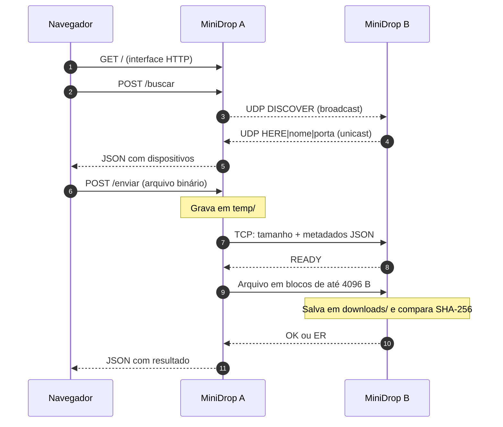

<div align="center">

# MiniDrop

### Daqui para ali. Na mesma rede.

**Compartilhamento de arquivos em rede local, construído com sockets Python para explorar HTTP, UDP e TCP na prática.**


**[Como executar](#como-executar) · [Arquitetura](#arquitetura-e-fluxo) · [Protocolo](#protocolo-de-transferência) · [Equipe](#equipe)**

</div>

---

## O projeto

O **MiniDrop** é uma aplicação de compartilhamento de arquivos entre computadores de uma **mesma rede local (LAN)**. A proposta é simples: localizar outras instâncias do programa, escolher um destino no navegador e enviar um arquivo diretamente pela rede — sem precisar fazer upload para um serviço externo.

Por trás de uma interface web, o MiniDrop integra **três papéis diferentes**:

- **HTTP sobre TCP:** disponibiliza a interface no navegador e recebe as ações do usuário.
- **UDP:** descobre outras instâncias MiniDrop com uma mensagem de broadcast e respostas individuais.
- **TCP:** transporta o arquivo entre as instâncias, com metadados e confirmação de integridade por **SHA-256**.

O servidor HTTP foi desenvolvido **manualmente com a biblioteca padrão do Python**, sem Flask, Django, FastAPI ou `http.server`. O projeto surgiu da expansão do servidor `TcpServerNew3.py`, disponibilizado como código-base na disciplina **Redes de Computadores I**.

> **Ideia central:** o TCP transporta um fluxo confiável e ordenado de bytes; o protocolo do MiniDrop define como interpretar esses bytes para enviar um arquivo.

## O que o MiniDrop faz

| Recurso | Como funciona |
|---|---|
| **Descoberta na rede** | `DISCOVER` por broadcast UDP; instâncias disponíveis respondem com `HERE|nome|porta`. |
| **Interface web** | Página HTML/CSS/JavaScript servida por um servidor HTTP próprio na porta `8080`. |
| **Seleção do destino** | Lista o nome, o IP e a porta TCP dos dispositivos encontrados. |
| **Upload pelo navegador** | `POST /enviar` recebe o arquivo e o armazena temporariamente antes de encaminhá-lo. |
| **Transferência TCP** | Metadados JSON e conteúdo binário em blocos de até **4096 bytes (4 KiB)**. |
| **Verificação de integridade** | Calcula SHA-256 na origem e no destino; o receptor responde `OK` ou `ER`. |
| **Serviços simultâneos** | Threads auxiliares mantêm os receptores UDP e TCP ativos enquanto o servidor HTTP executa. |

**Escopo:** é um protótipo acadêmico para uma rede local confiável, não uma ferramenta de transferência segura pela Internet.

## Arquitetura e fluxo



O **navegador não abre uma conexão TCP diretamente com o destinatário**. Ele conversa por HTTP com a instância MiniDrop que hospeda a interface. Essa instância é quem descobre os pares e estabelece a conexão TCP de transferência.

### Portas utilizadas

| Porta | Protocolo | Finalidade |
|---|---|---|
| `8080` | HTTP sobre TCP | Interface web e requisições `GET` e `POST`. |
| `5000` | UDP | Descoberta dos dispositivos. |
| `5001` | TCP | Recebimento do arquivo entre instâncias. |

As portas podem ser iguais em máquinas diferentes: cada conexão é identificada pelos endereços e portas de suas extremidades.

## Protocolo de transferência

Além de utilizar TCP, definimos um **protocolo simples de aplicação** para que emissor e receptor saibam interpretar a sequência de bytes:

| Ordem | Direção | Informação |
|:--:|---|---|
| 1 | A → B | **4 bytes**, em ordem *big-endian*, informando o comprimento dos metadados. |
| 2 | A → B | **JSON** com `nome`, `tamanho` (bytes) e `sha256`. |
| 3 | B → A | **`READY`** (5 bytes): receptor pronto. |
| 4 | A → B | **Conteúdo do arquivo**, em blocos de até 4096 bytes. |
| 5 | B → A | **`OK`** ou **`ER`** (2 bytes): resultado da comparação do SHA-256. |

Como TCP não preserva os limites entre mensagens da aplicação, a função `receber_exatamente()` acumula os bytes recebidos até completar os tamanhos esperados. Na transferência do conteúdo, o receptor utiliza o tamanho anunciado nos metadados para saber quando parar de ler.

O **SHA-256 verifica integridade, não criptografa o arquivo nem autentica o remetente**.

## Tecnologias e conceitos

**Python (biblioteca padrão):** `socket`, `threading`, `json`, `hashlib`, `os`, `time` e `urllib.parse`.

**Interface:** HTML, CSS e JavaScript, sem framework frontend.

**Redes:** IPv4, endereçamento e máscaras, broadcast/unicast, UDP, conexões TCP, sockets, HTTP, serialização JSON, fluxo de bytes e verificação de integridade. O tráfego pode ser examinado com o **Wireshark**.

## Como executar

**Pré-requisitos:** Python 3 instalado, navegador moderno e **dois computadores conectados à mesma rede local** para testar a transferência entre máquinas. Não há dependências de terceiros para instalar via `pip`.

1. Clone o repositório e entre na pasta do projeto:

   ```bash
   git clone https://github.com/SEU-USUARIO/minidrop.git
   cd minidrop
   ```

   > Substitua `SEU-USUARIO/minidrop` pelo endereço definitivo do repositório caso você escolha outro nome.

2. Inicie o MiniDrop **a partir da raiz do projeto** em cada computador:

   **Linux / Pop!_OS**

   ```bash
   python3 src/main.py
   ```

   **Windows**

   ```powershell
   py -3 src/main.py
   ```

3. No navegador do próprio computador, abra:

   **http://localhost:8080/**

4. Em uma das páginas, clique em **Atualizar**, escolha o dispositivo encontrado, selecione um arquivo e clique em **Enviar arquivo**.

5. Confira o resultado na interface, no terminal e na pasta `downloads/` do **receptor**.

> **Atenção aos caminhos:** a versão atual usa diretórios relativos (`web/`, `temp/` e `downloads/`). Por isso, execute `src/main.py` com o terminal posicionado na **raiz do repositório**, e não dentro da pasta `src/`.

### Acesso pelo celular

Um celular conectado à mesma rede pode abrir o MiniDrop de um computador pelo navegador, acessando `http://IP-DO-COMPUTADOR:8080/`.

Nesse caso, o celular **utiliza a interface**, mas não vira automaticamente uma instância MiniDrop: quem executa a descoberta e a transferência TCP é o computador que hospeda o servidor.

### Sobre broadcast e firewall

A descoberta usa um endereço configurado em `src/discovery.py`, atualmente `255.255.255.255`. Dependendo da rede e das interfaces disponíveis, pode ser necessário usar o **broadcast específico da sub-rede**. Por exemplo, em `172.20.10.0/28`, o broadcast é `172.20.10.15`. Não assuma que toda rede termina em `.255`.

Verifique também se os dispositivos conseguem se comunicar entre si (alguns roteadores e hotspots isolam os clientes). O firewall pode precisar permitir, na **rede confiável utilizada no teste**, conexões de entrada nas portas `5000/UDP`, `5001/TCP` e, para acesso remoto à interface, `8080/TCP`. **Não é necessário desativar o firewall inteiro.**

## Estrutura do repositório

```text
.
├── codigo-original/
│   └── TcpServerNew3.py     # ponto de partida da disciplina
├── src/
│   ├── main.py             # inicia threads UDP/TCP e servidor HTTP
│   ├── discovery.py        # DISCOVER, HERE e lista de pares
│   ├── transfer.py         # metadados, TCP, SHA-256 e arquivos
│   └── http_server.py      # requisições e respostas HTTP manuais
├── web/
│   ├── index.html
│   ├── style.css
│   └── app.js
├── docs/                   # registros e documentação do projeto
├── assets/equipe/          # avatares da equipe (substituíveis por fotos)
└── README.md
```

As pastas `temp/` e `downloads/` são usadas durante a execução. `temp/` armazena o upload antes do envio TCP; `downloads/` recebe os arquivos enviados por outras instâncias.

## Limitações e próximos passos

Este projeto prioriza a compreensão dos protocolos e uma implementação enxuta. Entre os pontos que podem evoluir:

- **Segurança:** não há autenticação de dispositivos nem TLS. Não exponha as portas à Internet.
- **Descoberta:** o broadcast não é calculado automaticamente e pode ser bloqueado pela rede ou pelo firewall.
- **HTTP:** as conexões são atendidas sequencialmente, e o upload é acumulado em memória antes da gravação temporária.
- **Transferência:** não há retomada automática após interrupções; falhas não são tratadas integralmente em todos os caminhos.
- **Armazenamento:** a versão atual pode sobrescrever arquivos recebidos com o mesmo nome e não remove automaticamente arquivos cujo hash divergiu.
- **Validação:** faltam testes automatizados, medição de vazão/latência e endurecimento das validações de entrada.

Esses pontos fazem parte do escopo de um **protótipo didático**, e são oportunidades de evolução para futuras versões.

## Origem acadêmica

Desenvolvido na disciplina **Redes de Computadores I**, como evolução de um exemplo de servidor HTTP com sockets TCP fornecido pelo professor. O trabalho explora, na prática, a separação entre protocolos de aplicação e transporte, a comunicação entre processos e a observação de pacotes de rede.

---

## Equipe

<table align="center">
  <tr>
    <td align="center">
      <a href="https://github.com/michellydarquia">
        <br>
        <sub><b>Michelly Darquia</b></sub>
      </a>
    </td>
    <td align="center">
      <a href="https://github.com/Isabella-Costa">
        <br>
        <sub><b>Isabella Costa</b></sub>
      </a>
    </td>
    <td align="center">
      <a href="https://github.com/Danielle-sn">
        <br>
        <sub><b>Danielle Stephany</b></sub>
      </a>
    </td>
  </tr>
</table>
</div>
